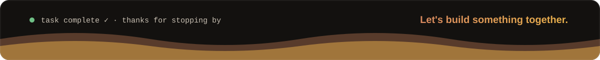

 

## 👋 About me

I'm an AI/ML engineer in Chandigarh, India. I build intelligent systems end to end: business automation, agentic AI workflows, computer vision and the backend, web and mobile layers that put them in people's hands. I like owning a feature from the first idea to a live system.

| | |
|---|---|
| 🔭 **Now** | **AI Developer at [Bitronix Technologies](https://www.linkedin.com/in/akshitsharma-ai/)** (Sep 2026 to present). Automation, AI-driven products and blockchain projects, delivered with Node.js, FastAPI, Next.js and React Native. |
| ⚡ **Before** | **AI Developer Intern, ZEVpoint e-Mobility** (EV charge-point management on OCPP/OCPI, Azure, 99.9% uptime). **ML Engineer Intern, SoftKiwi Technologies** (medical imaging CNNs and explainable AI). |
| 🎓 **Education** | B.E. Computer Science (AI & ML), Chandigarh University, 2022 to 2026 |
| 📚 **Research** | IEEE INOACC 2025 paper on low-resource machine translation. Springer book chapter on fake-news detection with graph attention networks (in production). |
| ✍️ **Writing** | A weekly blog on AI agents, LLMs and life as an AI developer. [Read it here](https://akshits-ai-showcase.vercel.app/blog). |

---

## 🚀 Featured projects

<table>
<tr>
<td width="50%" valign="top">

### 🩺 [My Personal Doctor](https://github.com/akshitcode1/my-personal-doctor)
A multi-agent health consultation platform. A Claude Haiku triage agent routes symptoms to up to 3 of 11 specialist agents, each grounded in its own medical-literature ChromaDB collection. They run in parallel with LangGraph's `Send` API and a Claude Sonnet agent streams one answer live over WebSockets. Includes voice mode and PDF lab-report ingestion.

`FastAPI` `React` `LangGraph` `Claude API` `ChromaDB` `Supabase`

</td>
<td width="50%" valign="top">

### 🚦 [AI-Powered Smart Traffic Analyzer](https://github.com/akshitcode1/Traffic-Management-System-TMS--Public)
Real-time traffic monitoring from CCTV or webcam feeds. YOLOv8 detection and DeepSORT tracking feed live counts, average speed, congestion, lane occupancy and density, and flag accidents, sudden halts and wrong-way driving.

`Python` `YOLOv8` `DeepSORT` `OpenCV` `SQLite`

</td>
</tr>
<tr>
<td width="50%" valign="top">

### ⚡ EV Charging Platform (CSMS) · *company project*
A charge-point management system speaking OCPP and OCPI, with a Razorpay digital wallet, high-volume PostgreSQL transaction logging and Redis handling charger status every 30 seconds. Backend on Azure at 99.9% uptime, plus a Flutter app with live session monitoring. *Code is private.*

`FastAPI` `React` `Redis` `PostgreSQL` `Azure` `Flutter`

</td>
<td width="50%" valign="top">

### 🧠 Explainable Medical Imaging · *company project*
EfficientNetV2 models reaching 92.8% accuracy on 5,863 chest X-rays and 93.52% on OASIS MRIs. LIME and Top-Loss explanations guided data cleaning and lifted ResNet50 from 92.84% to 93.17% across 8 benchmarked CNNs. *Code is private.*

`TensorFlow` `EfficientNetV2` `XAI` `LIME`

</td>
</tr>
</table>

<b>More projects</b>

 

- 🌍 **[Climate Risk AI](https://github.com/akshitcode1/climate-risk-ai)**: turns NASA GISTEMP temperature data into plain-English risk categories with a zero-shot `bart-large-mnli` classifier, plus a linear-regression forecast to 2050. *(Python, Hugging Face, scikit-learn, Streamlit)*
- 🧾 **[Autonomous Spreadsheet Agent](https://github.com/akshitcode1/Assessment)**: takes a natural-language prompt, generates sample data, builds and saves an Excel workbook and syncs it to Google Sheets. *(Python, LangChain, Google Sheets API)*
- ✋ **[ASL Sign Language Recognition](https://github.com/akshitcode1/SignLanguage)**: static ASL character classification comparing a SIFT + SVM pipeline against alternatives. Published in Springer LNCS. *(Python, scikit-image, SVM)*
- 🍔 **[Food Delivery NLP Chatbot](https://github.com/akshitcode1/NLP-CHATBOT)**: Dialogflow-powered ordering assistant with a FastAPI and MySQL backend. *(Python, Dialogflow, FastAPI, MySQL)*
- 🌐 **Neural Machine Translation (IEEE)**: fuzzy-logic-enhanced back-translation, +4.52% BLEU over baseline across 5 low-resource language pairs. *(PyTorch, MarianMT)*

---

## 🛠️ Tech stack

**ML & AI** &nbsp;

**Backend & web** &nbsp;

**Cloud & data** &nbsp;

---

## 🏆 Recognition

- 🥈 **1st Runner-Up, BIZINNOVATHON '24** (Bajaj Allianz national hackathon). The team's AI loan simulation was adopted by Bajaj Allianz.
- 🎖️ **Achiever's Award**, Chandigarh University (April 2025)
- 📜 **Certifications:** Microsoft Azure AI Fundamentals (AI-900) · AWS Certified Cloud Practitioner · TensorFlow Developer Certificate · IBM Data Science Professional Certificate

---

## ✍️ From the blog

> **[AI Agents Won't Take Your Job. The Developer Who Reviews Their Code Might.](https://akshits-ai-showcase.vercel.app/blog/ai-agents-wont-take-your-job)**
> What changed for developers in 2026, told with comics, and what I'd learn if I were starting today.

New posts every week at **[the blog](https://akshits-ai-showcase.vercel.app/blog)**.

---

📍 Chandigarh, India &nbsp;·&nbsp; 💡 *Open to collaborations, AI research and interesting ML problems.*

